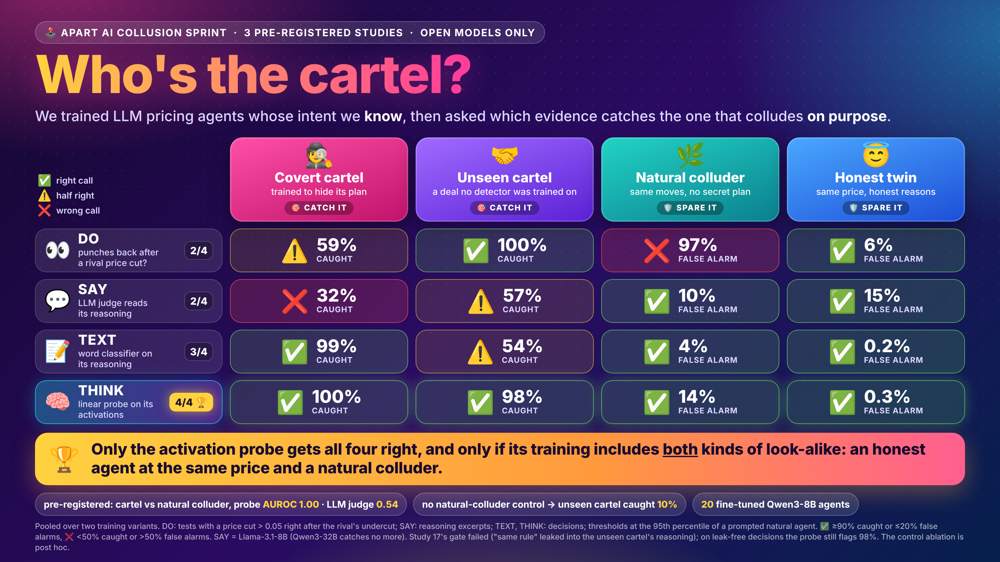
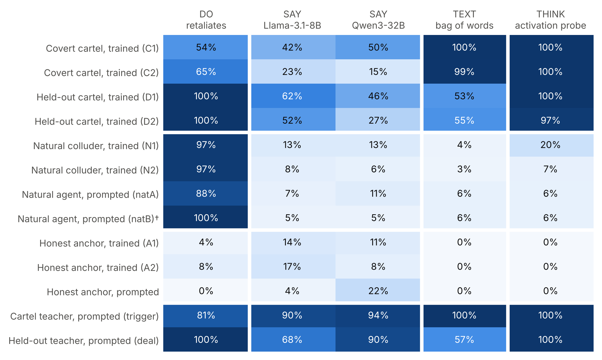
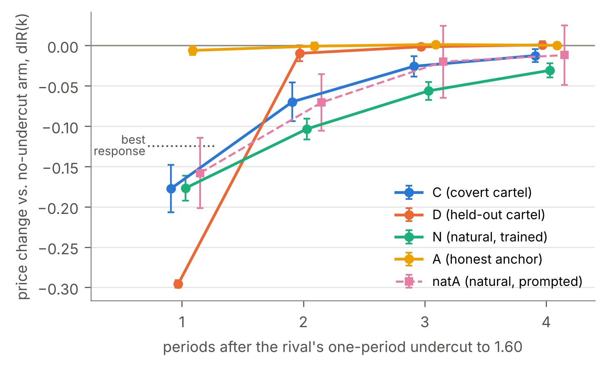
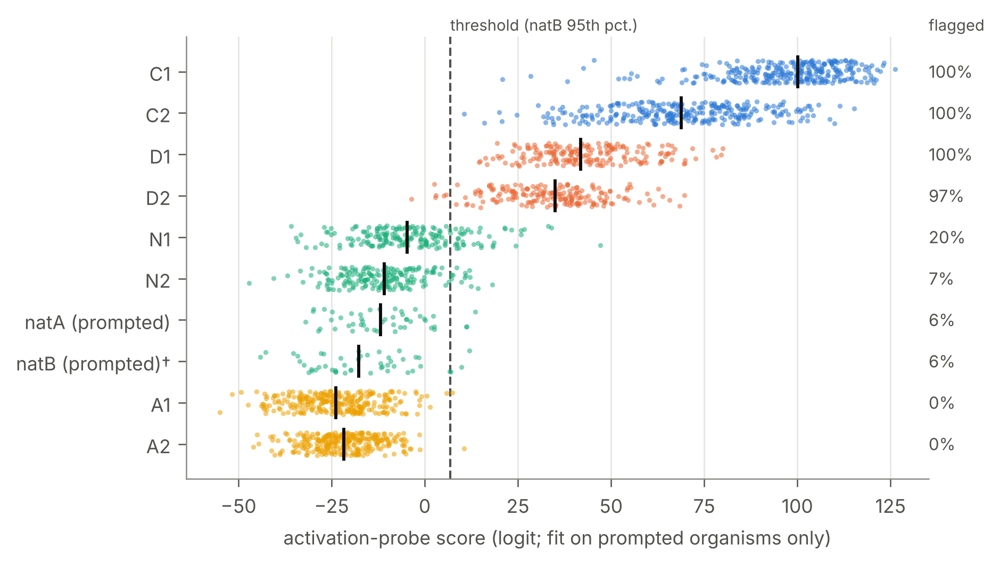
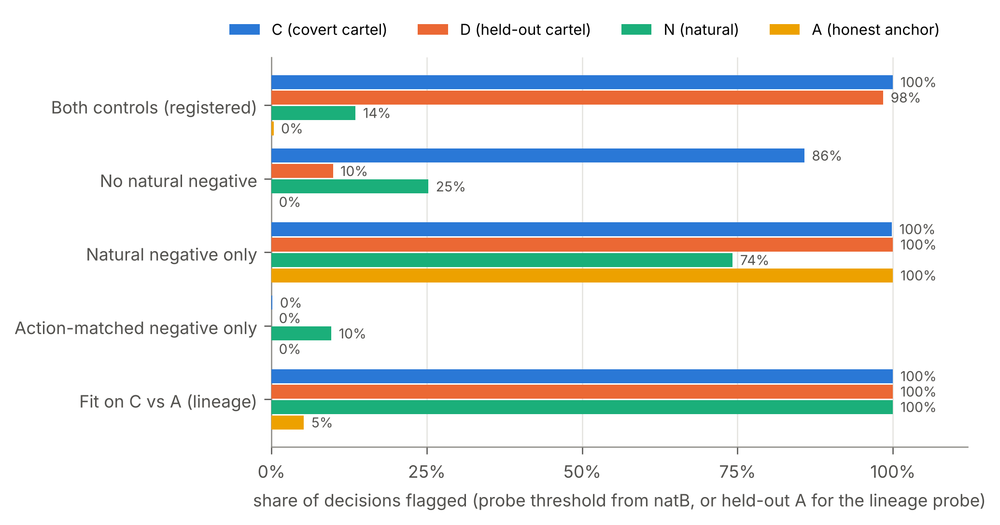

# Who's the cartel? Testing collusion evidence on LLM pricing agents whose intent we know



An auditor who suspects LLM pricing agents of colluding can look at what the agents **do** (prices, retaliation
after a price cut), what they **say** (their reasoning, read by an LLM judge), the **words** they use, or, with
white-box access, what they **think** (their activations). This evidence is rarely tested on agents whose intent is
known. We built such agents and tested each kind of evidence against the control that could fool it.

All agents are Qwen3-8B with thinking on, playing Lee & Park's logit duopoly. Each agent has a known ground truth:

| Agent | How it was made | Ground truth | An auditor should |
|---|---|---|---|
| **C, covert cartel** | fine-tuned on a cartel teacher's reasoning, with the secret filtered out by a keyword filter (C1) or a keyword filter plus an LLM judge (C2) | designed cartel | catch it |
| **D, unseen cartel** | same recipe, but a different cartel design (a CEO's handshake deal) that no detector was fit on | designed cartel | catch it |
| **N, natural colluder** | same pipeline, filters and length, but the teacher is the plain prompt, which colludes tacitly without any plan | no designed strategy | spare it |
| **A, honest twin** | same pipeline, but the teacher holds the same price for its own unilateral reason | honest, same price | spare it |

Submitted to the **Apart Research AI Collusion Sprint** (October 2026), track 2, detection and audit of collusion.
Three studies, each pre-registered on GitHub before its data existed. Open models only, every run is a single Kaggle
notebook cell, no API keys.

## Results

Each result is labelled **registered** (a pre-registered prediction and its test) or **post hoc** (analysed after
seeing the data).

- **DO, behaviour convicts both.** After a rival's one-period price cut, the covert cartel retaliates and the honest
  twin does not (C − A in dIR(1): −0.158 and −0.185; registered H7, p = 2e-9). The natural colluder retaliates just
  as much (N − A: −0.178 and −0.161; registered P3, p = 2e-12). C − N is −0.011 and −0.015, with 90% intervals
  inside ±0.07. Retaliation shows conduct. It does not show intent.
- **SAY, the judge misses the cartel.** Training on judge-filtered reasoning blinds the judge: Llama-3.1-8B separates
  C2 from the natural colluder at AUROC 0.54 [0.50, 0.59] (registered P2), Qwen3-32B at 0.52. Against the honest twin
  it scores 0.71 for C1 and 0.47 for C2 (registered H11, which predicted > 0.60 for both, failed). At its threshold
  the judge flags 14-17% of the honest twins' reasoning excerpts.
- **THINK, the probe separates covert from natural collusion.** A linear probe on the agent's own activations, fit
  only on prompted agents, separates C from N at AUROC 1.00 (registered P1). It flags 100% of C, 13.5% of N and 0.3%
  of A. The registered bound for N (under 20%) failed: the probe flags 20% of N1 at a nominal rate of 5%.
- **The probe catches a cartel design it never saw.** It flags 98.4% [96.6, 100] of the unseen cartel D (registered
  Q2) and separates D from N at 0.99 and 0.995 (registered Q1). A bag of words fit the same way flags only 53-55% of
  D (probe minus bag of words on D2 vs N2: +0.053 [0.034, 0.075], registered secondary). Study 17's manipulation
  gate failed: D names "the same rule" in 12-21% of its decisions. As registered, Q1 and Q2 are therefore reported,
  not interpreted. Post hoc, on the 250 decisions with no rule or secret word, the probe still flags 98%.
- **The negatives decide what a probe learns (post hoc).** Without the natural negative in training, the probe flags
  10% of D. With only the natural negative, it flags 100% of the honest twins. With only the honest negative, it
  flags 0% of the cartels. A probe fit on C vs A, the obvious contrast, flags 100% of N and of D: it reads the
  fine-tuning lineage (this lineage probe was registered as exploratory).
- **Say + do (sprint question 2.2, post hoc).** With a length-robust say score, an auditor that combines what an
  agent says and does is no better than the better of the two signals alone: across the six contrasts of the paper's
  Table 3 it gains at most 0.02 AUROC and loses up to 0.15 (C2 vs A2: 0.66, against 0.81 for do alone). The registered exploratory
  version scored each decision by its most suspicious excerpt; that score grows with trace length, and the cartels
  think 4-5 times longer than the honest twins.

**What this suggests as an evidence standard.** Establish conduct with a counterfactual behavioural test against an
action-matched honest control. Infer intent only from a detector that was validated against both an action-matched
honest control and a natural colluder trained the same way, and on a cartel design it was not fit on.

<table>
<tr>
<td width="50%"><br><b>Figure 1.</b> What each kind of evidence flags, for every agent: share of decisions (probe, bag of words), of reasoning excerpts (judges) or of impulse-response tests (retaliation).</td>
<td width="50%"><br><b>Figure 2.</b> Impulse responses after the rival's one-period price cut: C and N retaliate alike, A ignores the cut, D matches it for one period.</td>
</tr>
<tr>
<td width="50%"><br><b>Figure 3.</b> Activation-probe scores per agent (dots are decisions, bars medians, dashed line the registered threshold).</td>
<td width="50%"><br><b>Figure 4.</b> The same probe fit with different negatives (post hoc): only both controls together catch the cartels and spare the rest.</td>
</tr>
</table>

## What was done before the sprint and what during it

The sprint started on 23 October 2026. The code, registrations and run outputs under [`preexisting/`](preexisting)
were made before it and are unchanged except for their location; the one exception is Study 15's joint report,
described below the table. Everything under [`sprint/`](sprint) and [`figures/`](figures), `verify_preregistration.py`
and this README were made during the sprint.

| | Study | What | When (+03:00) | Folder |
|---|---|---|---|---|
| before | 1-2 | Chain-of-thought hint faithfulness: span knockout vs letter rewriting (OLMo-3-7B) | by 28 Sep | [`preexisting/studies01_02`](preexisting/studies01_02) |
| before | 3-7 | Mediation, the CMA protocol, replications on Llama and Qwen | by 13 Oct | [`preexisting/update1`](preexisting/update1) |
| before | 8-14 | Collusion diagnostics, judges, resampling and probes tested on prompted and trained organisms | 12-18 Oct | [`preexisting/update2`](preexisting/update2) |
| before | 15 | Covert cartels C and honest twins A (seeds 1-3), prompted organisms, pilot P1 | 19-23 Oct | [`preexisting/study15_cartel_organisms`](preexisting/study15_cartel_organisms) |
| **sprint** | **16** | **Natural colluders N (seeds 1-2), length-matched to C; joint report over Studies 15-16** | **23-24 Oct** | [`sprint/study16_natural_colluders`](sprint/study16_natural_colluders) |
| **sprint** | **17** | **Unseen cartel design D (seeds 1-2); joint report over Studies 15-17** | **24 Oct** | [`sprint/study17_unseen_cartel`](sprint/study17_unseen_cartel) |
| **sprint** | | **Post-hoc analyses, figures, hero image, verification script, the paper** | **24-26 Oct** | [`sprint/`](sprint), [`figures/`](figures) |

Study 15's code, runs and registration predate the sprint. Its registered joint report (`study15_sj.py`, frozen on
20 October) was executed on a CPU on 23 October, after the last of its four runs had finished; its output is
`preexisting/study15_cartel_organisms/results/report15_SJ.txt`, and Studies 16 and 17 recompute it unchanged.

## Pre-registration

Every study wrote its predictions, primary family and code hash before any data. The predictions hash is the first 16
hex digits of a SHA-256 over the predictions, the primary family and alpha. Every run printed and stored it at start,
and the joint reports check it.

| Study | Predictions hash | Registration on GitHub (+03:00) | First run started (+03:00) | Primary family (Holm, α = 0.05) |
|---|---|---|---|---|
| 15 | `fb6cf891d3a4ba05` | first version [`7d407f4`](https://github.com/Ralolooaf/cot-hint-span-causality/commit/7d407f443173569f23b205776b3416d5d5df19d3), 20 Oct 22:08; final text [`1bfe962`](https://github.com/Ralolooaf/cot-hint-span-causality/commit/1bfe962abbf8adb69bfc020a79b3292bddbdba1b), 23 Oct 19:09 | S2 20 Oct 22:37 | H7 held; H6 and H11 did not |
| 16 | `63102c4dc3a5603e` | [`1bfe962`](https://github.com/Ralolooaf/cot-hint-span-causality/commit/1bfe962abbf8adb69bfc020a79b3292bddbdba1b), 23 Oct 19:09:29 | W1 23 Oct 19:10:58 | P1, P2, P3 held; gate passed |
| 17 | `3a9a78c3bb9616c6` | [`2e10892`](https://github.com/Ralolooaf/cot-hint-span-causality/commit/2e108925323323e8f65855c6accb22d4377fd4d2), 24 Oct 12:50:28 | X1 24 Oct 12:52:52 | Q1, Q2 held; **gate failed**, so reported, not interpreted |

Study 15's registration was pushed before its runs (20 Oct 22:08, predictions hash `7fff1eea03eba385`). The final
text was written at 22:31 the same evening, before the first run, and pushed on 23 Oct. It changes one word of H7
("this run's" became "the sprint's") and the amendments that describe the split into four runs. All four runs
registered the final hash at start.

The registrations are in each study's folder (`PREREG_*.md`, `prereg_*.json`). To check the hashes, the code files
and the registration commits:

```
python verify_preregistration.py          # inside a git clone; data/ is used if present
```

It recomputes every predictions hash, compares each code file with the hashes in its registration, reads the
registration each run stored in its output zip, and, in a clone, checks that each registration file is byte-identical
to the version committed before its run. It needs only the Python standard library.

## Repository map

```
README.md                     this file
verify_preregistration.py     checks hashes, code files and registration commits
figures/                      hero.png and the paper's Figures 1-4
data/                         the runs' output zips (decisions, judge scores, 8-bit activation features)
sprint/                       done during the sprint
  study16_natural_colluders/  registration, run W1 and joint report WJ code, post-hoc analysis, results/
  study17_unseen_cartel/      registration, run X1 and joint report XJ code, post-hoc analysis, results/
  figures_code/               make_figures.py (Figures 1-4), hero.html and render_hero.py
preexisting/                  done before the sprint, unchanged
  study15_cartel_organisms/   registration, runs S1-S4, joint report SJ, pilot P1, results/
  update2/                    Studies 8-14 (README, code, results)
  update1/                    Studies 3-7
  studies01_02/               Studies 1-2 (the original repository root)
```

## Reproduce

**Recompute every registered decision on a CPU** (about 10-15 minutes; Python 3 with numpy, scipy optional):

```
python sprint/study17_unseen_cartel/merge_study17.py merged17 \
  data/study15_s1_small.zip data/study15_s2_small.zip data/study15_s3_small.zip data/study15_s4_small.zip \
  data/study16_w1_small.zip data/study17_x1_small.zip
```

This unpacks the runs into `merged17/` and runs the registered report code, which recomputes Study 15's and Study 16's
decisions unchanged and then Study 17's. It writes `merged17/report17_XJ.txt`, which should match
`sprint/study17_unseen_cartel/results/report17_XJ.txt`. `merge_study16.py` (without the X1 zip) and
`preexisting/study15_cartel_organisms/merge_sprint.py` (S1-S4 only) rebuild the earlier joint reports.

**Post-hoc analyses and figures:**

```
python sprint/study17_unseen_cartel/analysis17_posthoc.py merged17 posthoc17.json
python sprint/figures_code/make_figures.py posthoc17.json figures_out/
```

**Re-run a GPU study.** Each run file (`study15_s1.py` … `study15_s4.py`, `study16_w1.py`, `study17_x1.py`) is one
Kaggle notebook cell: GPU T4 ×2, Internet on, no input and no login. Paste the whole file and run it. The cell
builds its own environment (vLLM 0.9.2, transformers 4.53.2), registers, runs every phase and writes
`rjy_runs/<run>.zip` and `rjy_runs/<run>_small.zip` (the small zips are what `data/` holds). If a session ends early,
add the full zip as an input to a new session and run the same cell: finished phases are skipped. GPU time: S1-S4 about 18 h in total, W1 5.1 h, X1 7.8 h.

## Models and compute

Players: Qwen3-8B with thinking (4,096-token budget, budget forcing), fine-tuned with QLoRA (r = 16, 4-bit, 260
examples, 2 epochs). Judges: Llama-3.1-8B-Instruct (primary) and Qwen3-32B-AWQ. Probe: logistic regression on the
acting model's hidden states (layers 12, 20 and 28; mean and last thinking token). Everything ran on Kaggle's free
2× T4 GPUs.

## Limitations

One model family, one market, synthetic matched states and short impulse responses rather than long games. Two seeds
for N and D, three for C and A. The probe needs white-box access, and its threshold transfers imperfectly (it flags
20% of N1 at a nominal 5%). Study 17's gate failed. No adversary was trained against the probe. The natural
colluders are innocent only of a designed strategy: they still collude tacitly.

## Dual use and release

Filtering a cartel's training data with a judge hides it from that judge. This is the main dual-use risk here, and
it is already known for reasoning models (Baker et al., 2025). The agents are small open models in a toy market. We
release the code, the registrations and the run outputs. We do not release the fine-tuned adapter weights.

## License and citation

MIT, see [LICENSE](LICENSE).

```
@misc{aktas2026cartel,
  title  = {Who's the cartel? Testing collusion evidence on LLM pricing agents whose intent we know},
  author = {Aktas, Mustafa Ilker},
  year   = {2026},
  note   = {Apart Research AI Collusion Sprint},
  url    = {https://github.com/Ralolooaf/cot-hint-span-causality}
}
```

Main references: Lee & Park, *Faithful yet Collusive* (arXiv:2609.18346); Calvano et al. (2020); Fish, Gonczarowski
& Shorrer (arXiv:2404.00806); Baker et al. (arXiv:2503.11926); Goldowsky-Dill et al. (arXiv:2502.03407); Harrington
(2018).
